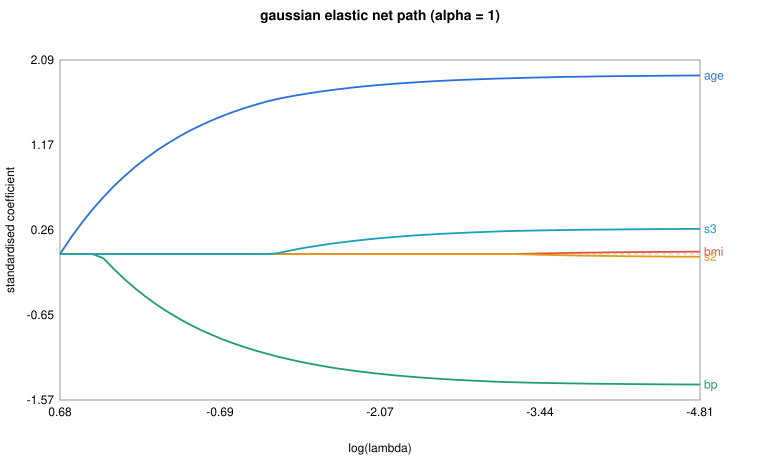

# enetpath

Elastic net regularisation paths for linear, logistic and Poisson regression, written from first principles in NumPy. It reproduces the machinery that makes R's glmnet fast and trustworthy (coordinate descent, warm starts, sequential strong rules with a KKT safety net, IRLS for GLMs, cross validated lambda selection) and then checks every piece of it against independent solvers and closed form answers.



*Lasso path for `examples/sample.csv`, produced by `python -m enetpath fit examples/sample.csv --target target --plot examples/sample_path.svg`.*

## Why this exists

The lasso and elastic net are the workhorses of sparse modelling: they do variable selection and shrinkage in one convex problem. In practice nobody fits a single lambda. You fit a whole path of a hundred lambdas and pick one by cross validation, so the interesting engineering is in making that path cheap and correct. That is what this project is about.

For every lambda on a decreasing grid, `enetpath` minimises

```
1/2 * sum_i w_i * d(y_i, mu_i)  +  lambda * sum_j pf_j * ( alpha * |b_j| + (1 - alpha)/2 * b_j^2 )
```

where `d` is the unit deviance of the family (squared error, binomial or Poisson), `w` are observation weights normalised to sum to one, `pf` are per feature penalty factors and `b` are coefficients on the standardised scale. With uniform weights this is exactly glmnet's objective, so results are directly comparable.

## Features

* **Three families**: Gaussian, binomial (logistic) and Poisson, all with canonical links.
* **Full path in one call** with glmnet's automatic lambda sequence: it starts at the smallest lambda that zeroes every penalised coefficient and runs down to `1e-4` (or `1e-2` when p > n) of that value on a log scale.
* **Sequential strong rules** discard most features before each fit; a full KKT check afterwards catches every case where the heuristic was wrong and refits.
* **Active set polishing**: once coordinate descent has found the support and signs, the restricted optimality conditions are a linear system. Solving it directly removes the slow tail of coordinate descent on correlated designs (10 to 20 times fewer sweeps on the test problems) and gets solutions to near machine precision.
* **IRLS with step halving** for the GLM families, so the outer loop is monotone even when the quadratic approximation overshoots.
* **Observation weights, penalty factors** (including unpenalised features with `pf = 0`), optional standardisation and intercept.
* **K fold cross validation** with deviance, MSE, MAE or misclassification loss, `lambda_min` and the one standard error rule `lambda_1se`.
* **Early stopping** when the path saturates (deviance ratio above 0.999 or no further progress), which also handles perfectly separable logistic data gracefully.
* **Dependency free SVG plots** of coefficient paths and CV curves, and a small CLI that works on any numeric CSV.

## Quick start

Only NumPy is required.

```bash
pip install numpy
python -m unittest discover        # 41 tests, about 15 seconds
python examples/demo.py            # sparse recovery demo, writes SVG plots
```

### Library

```python
import numpy as np
from enetpath import enet_path, cv_enet, path_svg

fit = enet_path(X, y, family="binomial", alpha=0.5)
fit.lambdas            # decreasing lambda sequence
fit.coefs              # (p, n_lambda) coefficients on the original scale
fit.dev_ratio          # fraction of null deviance explained
fit.predict(X_new, lam=0.05, kind="response")

cv = cv_enet(X, y, family="binomial", alpha=0.5, n_folds=10, measure="class")
intercept, coef = cv.coef("1se")
path_svg(cv.path, "path.svg")
```

### Command line

```bash
python -m enetpath fit examples/sample.csv --target target --every 15
python -m enetpath cv  examples/sample.csv --target target --alpha 0.5 --folds 5 --plot cv.svg
```

```
gaussian elastic net, alpha=1, n=97, p=6, 60 lambdas
step       lambda   df     %dev
   0      1.97101    0    0.000
  15     0.488234    2   79.192
  30     0.120939    3   86.783
  45    0.0299576    5   87.360
  59   0.00814423    5   87.410
```

Use `--family binomial|poisson`, `--alpha`, `--n-lambda`, `--no-standardize`, `--measure` and `--plot` to change the defaults.

## How it works

**Coordinate descent** (`enetpath/cd.py`). For fixed IRLS weights `W` and working response `z`, each coordinate has a closed form update: compute `g_j = sum W x_j r + v_j b_j`, soft threshold it by `lambda * alpha * pf_j`, and divide by `v_j + lambda * (1 - alpha) * pf_j`. The residual is updated in place, so a step costs O(n). As in glmnet, one sweep over all candidates alternates with repeated sweeps over the currently non zero coefficients until the largest weighted change is below tolerance.

**Polishing.** When the active set sweeps are nearly settled, the code solves the optimality equations on the active set (with intercept) as one linear system and accepts the result only if no coefficient changes sign. A full sweep then verifies that nothing outside the active set wants to enter. This was the single biggest performance win: a correlated 80 by 60 problem went from about 37,000 sweeps along the path to about 3,600.

**Strong rules** (`enetpath/path.py`). Before solving at `lambda_k`, feature `j` is dropped if `|s_j| < alpha * pf_j * (2 lambda_k - lambda_{k-1})`, where `s` is the score at the previous solution. The rule is a heuristic, so after each fit every discarded feature is checked against the KKT condition `|s_j| <= lambda * alpha * pf_j`; violators are added back and the fit is repeated. The number of repairs and the strong set size are recorded on the path object.

**GLMs.** The binomial and Poisson families wrap coordinate descent in IRLS. Each outer step builds the quadratic approximation of the deviance, solves it, and halves the step if the true penalised objective went up.

**Unpenalised features.** The "null" model is the intercept plus every feature with `pf = 0`. It is fitted first, and `lambda_max` is computed from the scores of the penalised features at that model, so the path really does start at the point where everything penalised is zero.

## Testing

The test suite is built around oracles that share no code with the solver.

* **Closed forms.** With an orthonormal design the solution is soft thresholding, exactly, at every lambda and for every alpha. Ridge (`alpha = 0`) is compared with the normal equations. At `lambda = 1e-12` with n > p the path must reproduce plain Newton's method maximum likelihood for all three families, and least squares when the intercept is off.
* **Independent solver.** `enetpath/oracle.py` implements FISTA with adaptive restarts and backtracking, stopping on the norm of the proximal gradient mapping. Coefficients agree with coordinate descent to `1e-8` across families and alphas, and the coordinate descent objective is never worse.
* **KKT everywhere.** Every point on every path is checked against the elastic net optimality conditions, including a p = 200, n = 40 problem.
* **Strong rules.** Paths with and without screening agree; a deliberately coarse lambda grid that provokes rule failures still produces the exact solution.
* **Invariances.** Rescaling a feature rescales its coefficient, shifting features changes nothing, permuting columns permutes coefficients, integer weights equal duplicated rows, zero weights equal dropped rows.
* **Edge cases.** Constant columns, separable logistic data, all zero penalty factors, invalid inputs, CV fold losses reproduced by hand, and the CLI end to end.

## Design notes

* Everything is computed on the standardised scale and mapped back at the end, which makes the penalty scale free and is what glmnet users expect. Pass `standardize=False` to penalise raw coefficients instead.
* Penalty factors are rescaled to sum to the number of features, matching glmnet, so multiplying them all by a constant changes nothing.
* For pure ridge the automatic `lambda_max` uses `alpha = 0.001`, the same convention glmnet uses, since the true value would be infinite.
* `coef_at` interpolates linearly in log lambda between path points, which is what glmnet's `coef(fit, s = ...)` does without `exact = TRUE`.
* The code favours clarity over raw speed. The inner loop is Python over coordinates with vectorised O(n) work per step, which is fine up to a few thousand rows and a few hundred features.

## Project layout

```
enetpath/
  families.py   Gaussian, binomial, Poisson: deviance, links, IRLS quantities
  cd.py         coordinate descent with active set cycling and polishing
  path.py       lambda sequence, strong rules, KKT checks, IRLS, path object
  cv.py         K fold cross validation, lambda_min and lambda_1se
  plot.py       SVG coefficient path and CV plots
  oracle.py     FISTA and Newton reference solvers used by the tests
  cli.py        command line interface
tests/          41 unittest cases
examples/       demo script and a sample CSV
```

## References

* Friedman, Hastie and Tibshirani (2010). Regularization Paths for Generalized Linear Models via Coordinate Descent. Journal of Statistical Software 33(1).
* Tibshirani, Bien, Friedman, Hastie, Simon, Taylor and Tibshirani (2012). Strong rules for discarding predictors in lasso type problems. JRSS B 74(2).
* Beck and Teboulle (2009). A Fast Iterative Shrinkage Thresholding Algorithm for Linear Inverse Problems. SIAM J. Imaging Sciences 2(1).

## License

MIT
